<!-- Generated by tools/build_profile.py; edit the data and generator to keep automatic updates consistent. -->

<picture>
  <source media="(prefers-color-scheme: dark)" srcset="assets/scene-dark.svg">
  <source media="(prefers-color-scheme: light)" srcset="assets/scene-light.svg">
  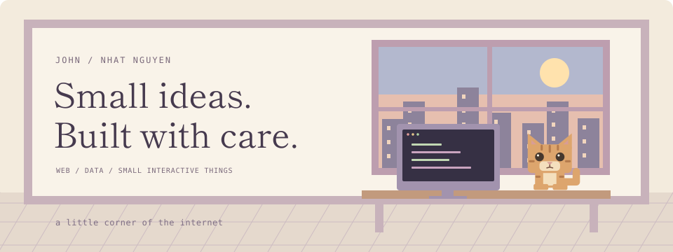
</picture>

<h2>
<picture>
  <source media="(prefers-color-scheme: dark)" srcset="assets/about-dark.svg">
  <source media="(prefers-color-scheme: light)" srcset="assets/about-light.svg">
  
</picture>
</h2>

I'm **Nhat Nguyen (John)**, a Computer Science student at **Swinburne Vietnam**, with a minor in **Data Science**.

I build web interfaces, explore data, and make small interactive projects. The orange companion above is based on my own cat.

[Portfolio projects](https://github.com/NhatNguyen2407/Portfolio) · [LinkedIn](https://www.linkedin.com/in/nhatnguyen2407) · [Email](mailto:john.bibibi@gmail.com)

<h2>
<picture>
  <source media="(prefers-color-scheme: dark)" srcset="assets/heading-focus-dark.svg">
  <source media="(prefers-color-scheme: light)" srcset="assets/heading-focus-light.svg">
  
</picture>
</h2>

<picture>
  <source media="(prefers-color-scheme: dark)" srcset="assets/terminal-dark.svg">
  <source media="(prefers-color-scheme: light)" srcset="assets/terminal-light.svg">
  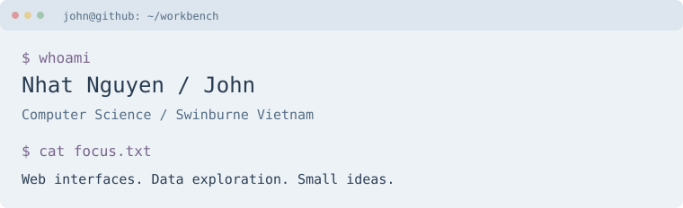
</picture>

<h2>
<picture>
  <source media="(prefers-color-scheme: dark)" srcset="assets/heading-work-dark.svg">
  <source media="(prefers-color-scheme: light)" srcset="assets/heading-work-light.svg">
  
</picture>
</h2>

<a href="docs/projects/dio.md">
<picture>
  <source media="(prefers-color-scheme: dark)" srcset="assets/project-dio-dark.svg">
  <source media="(prefers-color-scheme: light)" srcset="assets/project-dio-light.svg">
  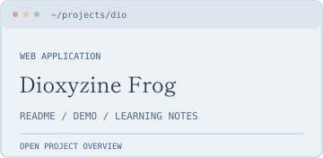
</picture>
</a>
<a href="docs/projects/management.md">
<picture>
  <source media="(prefers-color-scheme: dark)" srcset="assets/project-management-dark.svg">
  <source media="(prefers-color-scheme: light)" srcset="assets/project-management-light.svg">
  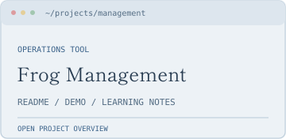
</picture>
</a>
<a href="docs/projects/retail.md">
<picture>
  <source media="(prefers-color-scheme: dark)" srcset="assets/project-retail-dark.svg">
  <source media="(prefers-color-scheme: light)" srcset="assets/project-retail-light.svg">
  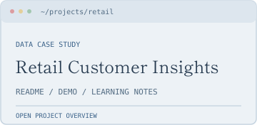
</picture>
</a>
<a href="docs/projects/football.md">
<picture>
  <source media="(prefers-color-scheme: dark)" srcset="assets/project-football-dark.svg">
  <source media="(prefers-color-scheme: light)" srcset="assets/project-football-light.svg">
  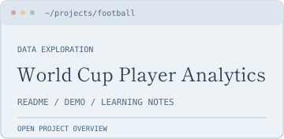
</picture>
</a>

<h2>
<picture>
  <source media="(prefers-color-scheme: dark)" srcset="assets/heading-notes-dark.svg">
  <source media="(prefers-color-scheme: light)" srcset="assets/heading-notes-light.svg">
  
</picture>
</h2>

Open project overviews, demos and learning notes

- **Dioxyzine Frog** - [Overview](docs/projects/dio.md) · [Source](https://github.com/NhatNguyen2407/Project/tree/main/Working_Projects/Dioxyzine_Frog) · [Demo](https://dioxyzinefrog.vercel.app)
- **Frog Management** - [Overview](docs/projects/management.md) · [Source](https://github.com/NhatNguyen2407/frog-management) · Local run instructions in the source
- **Retail Customer Insights** - [Overview](docs/projects/retail.md) · [Source](https://github.com/NhatNguyen2407/retail-customer-insights) · [Demo](https://retail-customer-insights.streamlit.app/)
- **World Cup Player Analytics** - [Overview](docs/projects/football.md) · [Source](https://github.com/NhatNguyen2407/football-analytics) · Local run instructions in the source

### A small storefront walkthrough

<picture><source media="(prefers-reduced-motion: reduce)" srcset="assets/project-walkthrough-still.svg"></picture>

Illustrative flow, not recorded application footage. Each overview explains the project's actual scope and limitations.

<h2>
<picture>
  <source media="(prefers-color-scheme: dark)" srcset="assets/heading-github-dark.svg">
  <source media="(prefers-color-scheme: light)" srcset="assets/heading-github-light.svg">
  
</picture>
</h2>

<picture>
  <source media="(prefers-color-scheme: dark)" srcset="assets/github-stats-dark.svg">
  <source media="(prefers-color-scheme: light)" srcset="assets/github-stats-light.svg">
  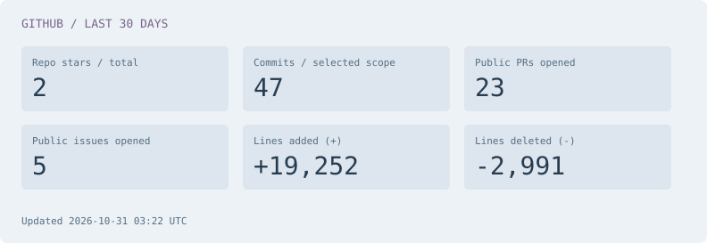
</picture>

Code changes: **30 days**, selected default branches and my linked GitHub author identity. PRs and issues: my public activity across GitHub. Stars: selected repositories, all time.

[Scope, exclusions and counting rules](docs/data-methods.md)

<h2>
<picture>
  <source media="(prefers-color-scheme: dark)" srcset="assets/heading-code-languages-dark.svg">
  <source media="(prefers-color-scheme: light)" srcset="assets/heading-code-languages-light.svg">
  
</picture>
</h2>

<picture>
  <source media="(prefers-color-scheme: dark)" srcset="assets/code-languages-dark.svg">
  <source media="(prefers-color-scheme: light)" srcset="assets/code-languages-light.svg">
  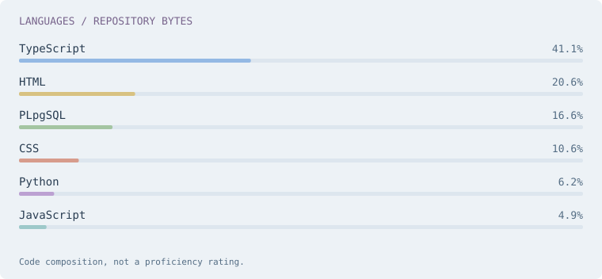
</picture>

Repository code composition, not a proficiency rating. The mixed coursework repository is excluded from this chart.

<table>
<tr>
<td valign="top" width="45%">
<h2>
<picture>
  <source media="(prefers-color-scheme: dark)" srcset="assets/heading-spoken-dark.svg">
  <source media="(prefers-color-scheme: light)" srcset="assets/heading-spoken-light.svg">
  
</picture>
</h2>
<table><thead><tr><th>Language</th><th>Current level</th></tr></thead><tbody>
<tr><td>Vietnamese</td><td>Native</td></tr>
<tr><td>English</td><td>Intermediate</td></tr>
<tr><td>German</td><td>Learning</td></tr>
<tr><td>Japanese</td><td>Learning</td></tr>
</tbody></table>
</td>
<td valign="top" width="55%">
<h2>
<picture>
  <source media="(prefers-color-scheme: dark)" srcset="assets/heading-chess-dark.svg">
  <source media="(prefers-color-scheme: light)" srcset="assets/heading-chess-light.svg">
  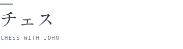
</picture>
</h2>
<a href="docs/chess.md">
<picture>
  <source media="(prefers-color-scheme: dark)" srcset="assets/chess-board-dark.svg?v=g-20261031-1-0">
  <source media="(prefers-color-scheme: light)" srcset="assets/chess-board-light.svg?v=g-20261031-1-0">
  
</picture>
</a>

Visitors play White. John plays Black.

Choose a legal move

<a href="https://github.com/NhatNguyen2407/NhatNguyen2407/issues/new?title=chess%7Cmove%7Ca2a3%7Cg-20261031-1%7C0&amp;body=Submit+this+issue+to+play+the+selected+move.+The+game+checks+the+position+and+whose+turn+it+is+before+accepting+it.">a3 (a2a3)</a> · <a href="https://github.com/NhatNguyen2407/NhatNguyen2407/issues/new?title=chess%7Cmove%7Ca2a4%7Cg-20261031-1%7C0&amp;body=Submit+this+issue+to+play+the+selected+move.+The+game+checks+the+position+and+whose+turn+it+is+before+accepting+it.">a4 (a2a4)</a> · <a href="https://github.com/NhatNguyen2407/NhatNguyen2407/issues/new?title=chess%7Cmove%7Cb2b3%7Cg-20261031-1%7C0&amp;body=Submit+this+issue+to+play+the+selected+move.+The+game+checks+the+position+and+whose+turn+it+is+before+accepting+it.">b3 (b2b3)</a> · <a href="https://github.com/NhatNguyen2407/NhatNguyen2407/issues/new?title=chess%7Cmove%7Cb2b4%7Cg-20261031-1%7C0&amp;body=Submit+this+issue+to+play+the+selected+move.+The+game+checks+the+position+and+whose+turn+it+is+before+accepting+it.">b4 (b2b4)</a> · <a href="https://github.com/NhatNguyen2407/NhatNguyen2407/issues/new?title=chess%7Cmove%7Cc2c3%7Cg-20261031-1%7C0&amp;body=Submit+this+issue+to+play+the+selected+move.+The+game+checks+the+position+and+whose+turn+it+is+before+accepting+it.">c3 (c2c3)</a> · <a href="https://github.com/NhatNguyen2407/NhatNguyen2407/issues/new?title=chess%7Cmove%7Cc2c4%7Cg-20261031-1%7C0&amp;body=Submit+this+issue+to+play+the+selected+move.+The+game+checks+the+position+and+whose+turn+it+is+before+accepting+it.">c4 (c2c4)</a> · <a href="https://github.com/NhatNguyen2407/NhatNguyen2407/issues/new?title=chess%7Cmove%7Cd2d3%7Cg-20261031-1%7C0&amp;body=Submit+this+issue+to+play+the+selected+move.+The+game+checks+the+position+and+whose+turn+it+is+before+accepting+it.">d3 (d2d3)</a> · <a href="https://github.com/NhatNguyen2407/NhatNguyen2407/issues/new?title=chess%7Cmove%7Cd2d4%7Cg-20261031-1%7C0&amp;body=Submit+this+issue+to+play+the+selected+move.+The+game+checks+the+position+and+whose+turn+it+is+before+accepting+it.">d4 (d2d4)</a> · <a href="https://github.com/NhatNguyen2407/NhatNguyen2407/issues/new?title=chess%7Cmove%7Ce2e3%7Cg-20261031-1%7C0&amp;body=Submit+this+issue+to+play+the+selected+move.+The+game+checks+the+position+and+whose+turn+it+is+before+accepting+it.">e3 (e2e3)</a> · <a href="https://github.com/NhatNguyen2407/NhatNguyen2407/issues/new?title=chess%7Cmove%7Ce2e4%7Cg-20261031-1%7C0&amp;body=Submit+this+issue+to+play+the+selected+move.+The+game+checks+the+position+and+whose+turn+it+is+before+accepting+it.">e4 (e2e4)</a> · <a href="https://github.com/NhatNguyen2407/NhatNguyen2407/issues/new?title=chess%7Cmove%7Cf2f3%7Cg-20261031-1%7C0&amp;body=Submit+this+issue+to+play+the+selected+move.+The+game+checks+the+position+and+whose+turn+it+is+before+accepting+it.">f3 (f2f3)</a> · <a href="https://github.com/NhatNguyen2407/NhatNguyen2407/issues/new?title=chess%7Cmove%7Cf2f4%7Cg-20261031-1%7C0&amp;body=Submit+this+issue+to+play+the+selected+move.+The+game+checks+the+position+and+whose+turn+it+is+before+accepting+it.">f4 (f2f4)</a> · <a href="https://github.com/NhatNguyen2407/NhatNguyen2407/issues/new?title=chess%7Cmove%7Cg2g3%7Cg-20261031-1%7C0&amp;body=Submit+this+issue+to+play+the+selected+move.+The+game+checks+the+position+and+whose+turn+it+is+before+accepting+it.">g3 (g2g3)</a> · <a href="https://github.com/NhatNguyen2407/NhatNguyen2407/issues/new?title=chess%7Cmove%7Cg2g4%7Cg-20261031-1%7C0&amp;body=Submit+this+issue+to+play+the+selected+move.+The+game+checks+the+position+and+whose+turn+it+is+before+accepting+it.">g4 (g2g4)</a> · <a href="https://github.com/NhatNguyen2407/NhatNguyen2407/issues/new?title=chess%7Cmove%7Ch2h3%7Cg-20261031-1%7C0&amp;body=Submit+this+issue+to+play+the+selected+move.+The+game+checks+the+position+and+whose+turn+it+is+before+accepting+it.">h3 (h2h3)</a> · <a href="https://github.com/NhatNguyen2407/NhatNguyen2407/issues/new?title=chess%7Cmove%7Ch2h4%7Cg-20261031-1%7C0&amp;body=Submit+this+issue+to+play+the+selected+move.+The+game+checks+the+position+and+whose+turn+it+is+before+accepting+it.">h4 (h2h4)</a> · <a href="https://github.com/NhatNguyen2407/NhatNguyen2407/issues/new?title=chess%7Cmove%7Cb1a3%7Cg-20261031-1%7C0&amp;body=Submit+this+issue+to+play+the+selected+move.+The+game+checks+the+position+and+whose+turn+it+is+before+accepting+it.">Na3 (b1a3)</a> · <a href="https://github.com/NhatNguyen2407/NhatNguyen2407/issues/new?title=chess%7Cmove%7Cb1c3%7Cg-20261031-1%7C0&amp;body=Submit+this+issue+to+play+the+selected+move.+The+game+checks+the+position+and+whose+turn+it+is+before+accepting+it.">Nc3 (b1c3)</a> · <a href="https://github.com/NhatNguyen2407/NhatNguyen2407/issues/new?title=chess%7Cmove%7Cg1f3%7Cg-20261031-1%7C0&amp;body=Submit+this+issue+to+play+the+selected+move.+The+game+checks+the+position+and+whose+turn+it+is+before+accepting+it.">Nf3 (g1f3)</a> · <a href="https://github.com/NhatNguyen2407/NhatNguyen2407/issues/new?title=chess%7Cmove%7Cg1h3%7Cg-20261031-1%7C0&amp;body=Submit+this+issue+to+play+the+selected+move.+The+game+checks+the+position+and+whose+turn+it+is+before+accepting+it.">Nh3 (g1h3)</a>

<a href="docs/chess.md">Play via GitHub Issues / How it works</a>

</td>
</tr>
</table>

<h2>
<picture>
  <source media="(prefers-color-scheme: dark)" srcset="assets/heading-music-dark.svg">
  <source media="(prefers-color-scheme: light)" srcset="assets/heading-music-light.svg">
  
</picture>
</h2>

<a href="docs/music-setup.md">
<picture>
  <source media="(prefers-color-scheme: dark)" srcset="assets/music-pending-dark.svg">
  <source media="(prefers-color-scheme: light)" srcset="assets/music-pending-light.svg">
  
</picture>
</a>

A soft spot for Japanese music and slower love songs. [Connect the listening cards](docs/music-setup.md).

<h2>
<picture>
  <source media="(prefers-color-scheme: dark)" srcset="assets/heading-updates-dark.svg">
  <source media="(prefers-color-scheme: light)" srcset="assets/heading-updates-light.svg">
  
</picture>
</h2>

- 2026-10-29 - [Pushed changes to NhatNguyen2407/frog-management](https://github.com/NhatNguyen2407/frog-management)
- 2026-10-28 - [Pushed changes to NhatNguyen2407/frog-management](https://github.com/NhatNguyen2407/frog-management)
- 2026-10-27 - [Pushed changes to NhatNguyen2407/frog-management](https://github.com/NhatNguyen2407/frog-management)
- 2026-10-26 - [Pushed changes to NhatNguyen2407/frog-management](https://github.com/NhatNguyen2407/frog-management)
- 2026-10-25 - [Pushed changes to NhatNguyen2407/frog-management](https://github.com/NhatNguyen2407/frog-management)

<h2>
<picture>
  <source media="(prefers-color-scheme: dark)" srcset="assets/heading-contributions-dark.svg">
  <source media="(prefers-color-scheme: light)" srcset="assets/heading-contributions-light.svg">
  
</picture>
</h2>

<picture>
  <source media="(prefers-color-scheme: dark)" srcset="assets/contributions-dark.svg">
  <source media="(prefers-color-scheme: light)" srcset="assets/contributions-light.svg">
  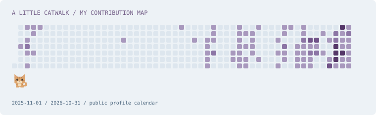
</picture>

A little catwalk around my contribution map.

Small ideas. Built with care.
